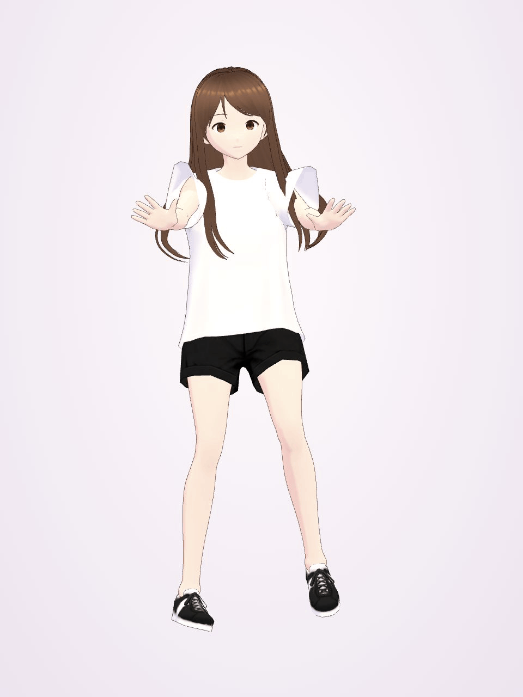
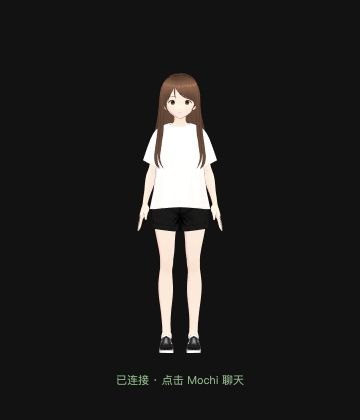
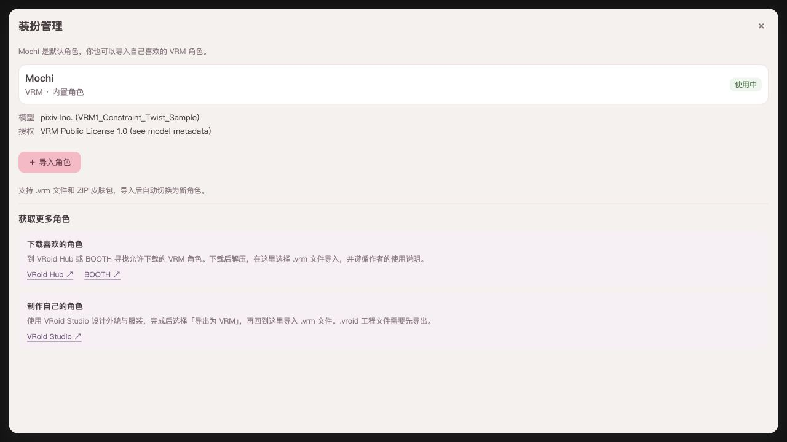
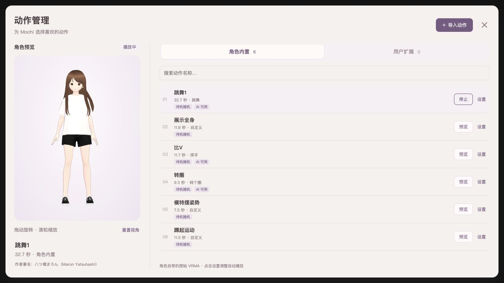
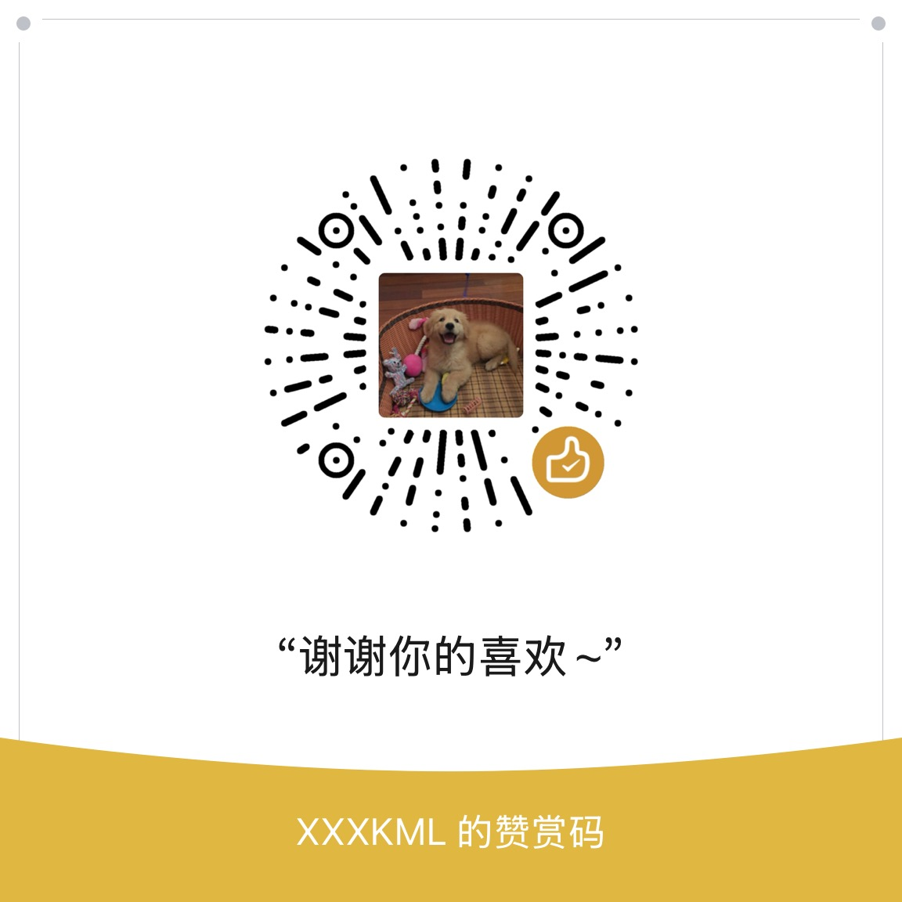

<div align="center">

#  团子 Mochi

[](https://github.com/liyu-1028/mochi/releases)
[](./LICENSE)
[](#️-安装与使用发行版)
[](https://v2.tauri.app/)

**捏出你的专属 AI 伙伴，让智能体拥有温暖的模样** 🍡

团子 Mochi 是一个会成长的桌面智能伙伴：把冰冷的命令行和对话框，
升级为有温度、有形象、可陪伴的桌面存在。
前端以 VRM + Three.js 渲染 3D 角色，动作采用 VRMA，后端由 LangGraph 驱动。
产品后续只围绕 VRM 角色继续发展，不再使用 Live2D 作为角色渲染方向。

[快速开始](#-快速开始) · [功能演示](#%EF%B8%8F-功能演示) · [安装使用](#️-安装与使用发行版) · [参与贡献](#-参与贡献)

已收录于 [Agent2048](https://agent2048.com/zh/projects/ipriqjvx2gnh)

</div>

> 🚧 当前阶段：Beta，应用版本为 [v0.16.0](https://github.com/liyu-1028/mochi/releases/tag/v0.16.0)。
> 以下功能状态按 2026-10-25 核对；本版加入百炼云语音与按住说话，不开语音也能看到回复动作和表情。
> 完整状态与 V1.0 路线图见 [产品功能全貌](docs/feature-list.md)。

## ✨ 功能特性

### 🍡 桌面里的 3D 角色

- ✅ **VRM + Three.js 渲染** —— 默认使用 Mochi 3D 角色，支持自然站姿、眨眼、视线与音量驱动口型；角色状态与 Agent 实时联动
- 🚧 **情绪反馈** —— 已接入 7 类情绪标签；开心、难过、惊讶、生气映射到模型表情，中性用于复位，困惑与害羞尚无可见的 VRM 表情实现
- ✅ **桌面互动** —— 视线跟随光标，点击唤出对话，拖拽调整位置；点按与长按的肢体反馈需配置对应的 VRMA 动作
- ✅ **性能护栏** —— 高负载自动降帧，支持省电模式

### 🎨 捏出你的专属伙伴

- ✅ **角色自由导入** —— 在装扮管理中导入 `.vrm`，支持 VRM 0.x / 1.0，展示模型作者与许可，换装无需重启
- ✅ **VRMA 动作扩展** —— 下载 `.vrma` 后在动作管理中导入，绑定用途、记录作者署名，按需启用待机播放或 AI 使用
- ✅ **可旋转的动作预览** —— 拖动切换视角、滚轮缩放，确认效果后再使用
- ✅ **人格定制** —— 组合灵魂、性格与说话风格预设，或填写自定义人设，下一轮对话生效

### 💬 有温度的对话

- ✅ **流式对话** —— 气泡流式输出，Markdown / 代码块渲染，随时打断
- ✅ **会话与长期记忆** —— 在聊天回忆中新建或继续会话；自动提取与手动保存的偏好、关键事实跨会话召回，支持编辑与删除
- ✅ **语音开口** —— 接入阿里云百炼 CosyVoice，支持音色 / 语速 / 音量调节和试听；默认关闭，配置百炼连接与 API Key 后手动开启，按服务商规则计费
- ✅ **按住说话** —— 按住麦克风录音，松开后由百炼 Paraformer 转写，文字可编辑后发送；单次最多 60 秒，Esc 取消，需要百炼连接与麦克风权限

### 🧠 强大的 Agent 内核

- ✅ **多模型接入** —— OpenAI 兼容接口（Chat / Responses）/ Anthropic / Ollama 本地模型，热切换无需重启
- ✅ **工具调用** —— 已内置时间查询与文本文件读取，支持工具调用与结果回流、进度展示和停止；读取用户文件等敏感操作经用户确认或白名单授权
- ✅ **本地存储** —— 配置 / 历史 / 记忆 / 动作库存于本机，API Key 存入 OS 钥匙串；使用云端模型或百炼语音时，相应文本或录音会发送至所选服务
- ✅ **事件协议** —— 前后端通过[标准事件协议 v0.1](docs/protocol/agent-events-v0.1.md)通信，为后续第三方 Agent 接入提供契约
- ✅ **设置与维护** —— 支持设置备份导入 / 导出、诊断包导出、应用版本展示与 GitHub 新版本提示；更新需前往发布页手动下载安装

### 🗓️ 待完善与规划

- 🚧 **VRM 表现力** —— 继续补齐困惑、害羞等可见反馈，扩充实际可播放的动作资源与用途
- ⬜ **Live2D 历史代码清理** —— 角色产品路线已确定为 VRM；旧兼容实现、依赖与 Cubism 下载脚本仍待移除
- ⬜ **后续能力** —— 联网搜索、日程提醒、全局快捷键和插件系统等仍在路线图中；具体优先级与验收标准见[产品功能全貌](docs/feature-list.md)

## 🖼️ 功能演示

<h3 align="center">Mochi · VRM 角色跳舞</h3>
<div align="center">

</div>

演示为应用真实播放的 960 × 1280 高清短片段（约 6 秒），无配乐。动作「愛包ダンスホール」来自
**八ツ橋まろん（Maron Yatsuhashi）**，通过 VRMA 播放，并作为 Mochi 的内置动作随安装包提供。

<div align="center">

</div>

<div align="center">
<table>
<tr>
<td align="center"></td>
<td align="center"></td>
</tr>
<tr>
<td align="center">装扮管理：下载模型或自行制作后导入</td>
<td align="center">动作管理：导入、预览、设置与署名</td>
</tr>
</table>
</div>

发行包预装六个 Mochi 内置动作：跳舞、展示全身、比 V、转圈、模特摆姿势和蹲起运动。
你也可以按下方指引继续导入喜欢的动作，归为角色内置或用户扩展。
六个动作并非都能由 AI 调用；待机播放、AI 使用和具体触发用途分别受动作设置控制。

## 🎭 换一个你喜欢的角色

作者不是“二次猿”，对二次元文化和角色设定了解不多，所以目前只内置了一个
风格比较干净、温柔的 **Mochi**。角色采用 pixiv 官方 VRM 示例模型，并非作者原创。
如果它不合你的口味，你们可以选择自己满意的模型：

1. 在 [VRoid Hub 官方平台](https://hub.vroid.com/en) 找到作者允许下载的角色，
   下载并解压得到 `.vrm` 文件。不是所有展示的角色都开放下载，请查看各自的使用条件。
2. 右键 Mochi → **换个装扮（装扮管理）** → **导入角色**，选择 `.vrm`。
3. 也可以使用 [VRoid Studio 官网](https://vroid.com/en/studio) 提供的软件自行制作，
   **导出为 VRM** 后再导入 Mochi；`.vroid` 是工程文件，不能直接作为角色导入。

社区创作者也会在 [BOOTH](https://booth.pm/) 发布角色模型。下载、使用或分享时，
请遵循对应作者的模型许可与署名要求。

## 💃 添加自己的动作

角色文件 `.vrm` 和动作文件 `.vrma` 分别导入。发行包预装六个 VRMA 动作，
按原始素材播放并保留作者署名。
眨眼、视线、表情和口型由角色渲染驱动提供；其他角色未配置动作时保持自然站姿。

1. 从 [VRoid 官方 VRMA 动作包](https://booth.pm/ja/items/5512385) 或创作者页面
   下载动作，解压取得 `.vrma`。
2. 右键角色 → **动作管理** → **导入动作**，填写动作名称和作者要求的署名。
3. 按实际内容选择用途：问候可以绑定“挥手”，舞蹈可以绑定“跳舞”，无法对应的
   动作选“自定义动作”。选成某个用途不会把原动作转换为另一种动作。
4. 点击 **预览**，拖动旋转视角、滚轮缩放；确认效果后再按需开启待机随机播放
   或“允许 AI 使用所选用途”。

“角色内置”表示你为当前角色配置的默认动作，“用户扩展”用于额外收藏。
同一用途只能绑定一个文件；替换自己的动作时，先删除旧条目再导入。
AI 可选用途清单根据已配置的动作资源、语义白名单与“允许 AI 使用”设置生成，回复可通过全角括号描写或隐藏 cue 标记触发动作；
回复动作与显式表情在语音正常播放时按播报进度调度；关闭、静音、未配置语音或播报失败时，按可见文字流演出。
语音准备超过 4 秒会先释放文字节拍，之后同回合的音频仍可播放，不会重复动作。停止或切换会话会清理旧表演。
靠墙、趴输入框、靠气泡、探头、回中间五个位置指令已从主干移除，位置动作的触发流程保留，当前没有可调用的位置指令。
详细说明见 [VRMA 导入指南](docs/specs/vrma-import-workflow.md) 和
[官方七动作包中文说明](assets/VRMA_MotionPack/README.md)。素材不属于项目 MIT 许可。

## 🚀 快速开始

```bash
pnpm install                 # JS 依赖 + husky 钩子（postinstall 自动下载默认 VRM 模型与 Live2D Core）
cd server && uv sync && cd .. # Python 依赖

./scripts/start.sh            # 一键启动桌面端：Tauri 窗口 + vite + sidecar
./scripts/stop.sh             # 一键停止桌面端（--all 连同 Ollama）
./scripts/start.sh --web-only # 仅启动浏览器侧：vite（1420）+ sidecar（不开窗口）
```

> 默认 VRM 模型由 `scripts/download-vrm-assets.mjs` 按固定来源下载并校验 SHA256。
> 发行包中的六个内置动作素材未纳入公开源码，也不会由 `pnpm install` 下载；
> 从源码启动时，可在动作管理中自行导入 `.vrma`。没有待机动作时，角色保持自然站姿。
> 当前安装流程仍会为历史 Live2D 兼容路径下载 Cubism Core，该路径待后续清理；相关许可见
> [角色资产声明](LICENSE-Live2D.md)。

或按需单独启动：

```bash
pnpm dev:server              # sidecar（http://127.0.0.1:8199/health）
pnpm dev:web                 # 前端（http://localhost:1420）
pnpm dev                     # Tauri 桌面应用（开发模式，需 Rust 环境）
```

代码检查：`pnpm lint` · `pnpm typecheck` · `pnpm format`

## ⌨️ 开发环境

| 层         | 选型                                                                 |
| ---------- | -------------------------------------------------------------------- |
| 桌面壳     | Tauri v2（Rust）                                                     |
| 前端       | React 19 + TypeScript + Vite                                         |
| 角色渲染   | Three.js + @pixiv/three-vrm · VRM 模型与 VRMA 动作                   |
| Agent 后端 | Python sidecar（FastAPI + LangGraph）                                |
| 前后端通信 | 本地 WebSocket · [事件协议 v0.1](docs/protocol/agent-events-v0.1.md) |

| 工具    | 版本基线                                        | 安装                                                                                                                                |
| ------- | ----------------------------------------------- | ----------------------------------------------------------------------------------------------------------------------------------- |
| Node.js | 20.x（`.nvmrc` 固定）                           | `nvm use`                                                                                                                           |
| pnpm    | 10.8.1（`packageManager` 字段固定）             | `corepack enable`（自动匹配固定版本）                                                                                               |
| Rust    | 1.97.1（`rust-toolchain.toml` 固定，自动安装）  | `curl --proto '=https' --tlsv1.2 -sSf https://sh.rustup.rs \| sh`，另需 [Tauri 平台依赖](https://v2.tauri.app/start/prerequisites/) |
| uv      | ≥0.12（CI 固定 0.12.1）                         | `curl -LsSf https://astral.sh/uv/install.sh \| sh`                                                                                  |
| Python  | 3.12（`server/.python-version` 固定，无需手装） | 由 uv 自动安装                                                                                                                      |

> 依赖可复现：三端锁文件（`pnpm-lock.yaml` / `server/uv.lock` /
> `Cargo.lock`）均已入库；CI 与发行流程按上表所列文件选择工具链。
> 升级基线时同步修改对应文件
> 与 `.github/workflows/` 中的引用。

## 📦 安装与使用（发行版）

从 [GitHub Releases](https://github.com/liyu-1028/mochi/releases/latest) 下载对应平台的发行包。
Python sidecar 由 PyInstaller 打成独立可执行随包
分发（用户机器不需要 Python 环境），桌面壳自动拉起并在异常时自动重启。

- **macOS 12+**（Apple Silicon / Intel）：`Mochi_<版本>_<架构>.dmg` → 拖入
  应用程序文件夹。
- **Windows 10+**（x64）：`Mochi_<版本>_x64-setup.exe` 安装包，或
  `Mochi_<版本>_x64-portable.zip` 便携版。便携版解压到可写目录后运行 `Mochi.exe`，
  数据保存在便携目录；需要系统已安装 WebView2 运行时。

<details>
<summary><b>⚠️ 首次打开提示「已损坏」或「无法验证开发者」怎么办？</b></summary>

当前阶段安装包**未签名、未公证**，macOS Gatekeeper / Windows SmartScreen
可能拦截从网络下载的未知应用。确认安装包来自本仓库的 GitHub Releases 后，可按以下步骤打开。

**macOS — 提示「已损坏，无法打开」：**

打开「终端」（Terminal），粘贴以下命令并回车（会清除系统的网络下载标记）：

```bash
xattr -cr /Applications/Mochi.app
```

之后即可正常双击打开。如果安装到了其他位置，将路径替换为实际路径即可。

> 💡 更轻量的替代：在 Finder 中对 `Mochi.app` **右键 → 打开**，
> 在弹出的对话框中点击「打开」，此后双击就不会再拦截了。
> 但部分 macOS 版本仍会报「已损坏」，此时请用上面的 `xattr` 命令。

**Windows — SmartScreen 提示「未知发布者」或「Windows 已保护你的电脑」：**

点击弹窗中的 **「更多信息」** → **「仍要运行」** 即可。
当前安装包缺少代码签名证书，因此可能显示此提示。

</details>

自行构建安装包：

```bash
# macOS 一条龙：打包 dmg → 安装到 /Applications → 启动（--app 跳过 dmg 更快）
./scripts/build-install-run.sh

# 或手动分步：
pnpm install && (cd server && uv sync)
pnpm --filter @mochi/desktop build      # tsc + tauri build，自动打包 sidecar
# 产物：apps/desktop/src-tauri/target/release/bundle/dmg/*.dmg（macOS）
#        或 bundle/nsis/*.exe（Windows，需在 Windows 上构建）
```

> sidecar 与目标机同架构现机构建（PyInstaller 不支持交叉编译）；
> 打包选型与冷启动实测见 ADR-0004（docs/internal/，不入库）。

## 📚 文档索引

| 文档                                                                     | 内容                                 |
| ------------------------------------------------------------------------ | ------------------------------------ |
| [docs/feature-list.md](docs/feature-list.md)                             | 产品功能全貌、实现状态与 V1.0 路线图 |
| [docs/protocol/agent-events-v0.1.md](docs/protocol/agent-events-v0.1.md) | Agent 事件协议 v0.1                  |
| [docs/specs/monorepo-structure.md](docs/specs/monorepo-structure.md)     | 仓库结构与工作区规则                 |
| [docs/specs/code-style.md](docs/specs/code-style.md)                     | 代码规范与提交钩子                   |
| [docs/specs/commit-convention.md](docs/specs/commit-convention.md)       | Git 与 Commit 规范                   |
| [docs/specs/config-format.md](docs/specs/config-format.md)               | 用户配置格式规范                     |
| [docs/specs/chat-sessions.md](docs/specs/chat-sessions.md)               | 聊天会话与历史回看                   |
| [docs/specs/memory-behavior.md](docs/specs/memory-behavior.md)           | 长期记忆的保存与召回                 |
| [docs/specs/vrma-import-workflow.md](docs/specs/vrma-import-workflow.md) | VRMA 动作导入与播放设置              |

## 🤝 参与贡献

欢迎提交 Issue 与 Pull Request！提交前请先阅读
[代码规范](docs/specs/code-style.md)与 [Commit 规范](docs/specs/commit-convention.md)。

## 💬 联系作者

欢迎添加作者微信交流（请备注来意）：


## ☕ 赞赏

如果你喜欢团子 Mochi，不妨赞赏作者，请它再吃一颗小团子 🍡
你的每一份喜欢，都是它继续成长的养分。



## ⭐ Star History

[](https://star-history.com/#liyu-1028/mochi&Date)

## 🔗 许可证

- **源代码**：[MIT](LICENSE)
- **角色资产**（`assets/`）：独立许可，见 [LICENSE-Live2D.md](LICENSE-Live2D.md) ——
  默认 VRM 模型、用户下载的角色/动作与 Live2D 兼容资源分别遵循各自许可，不在项目 MIT 覆盖范围内。

---

<div align="center">

**Enjoy your new companion!** 🍡

</div>
